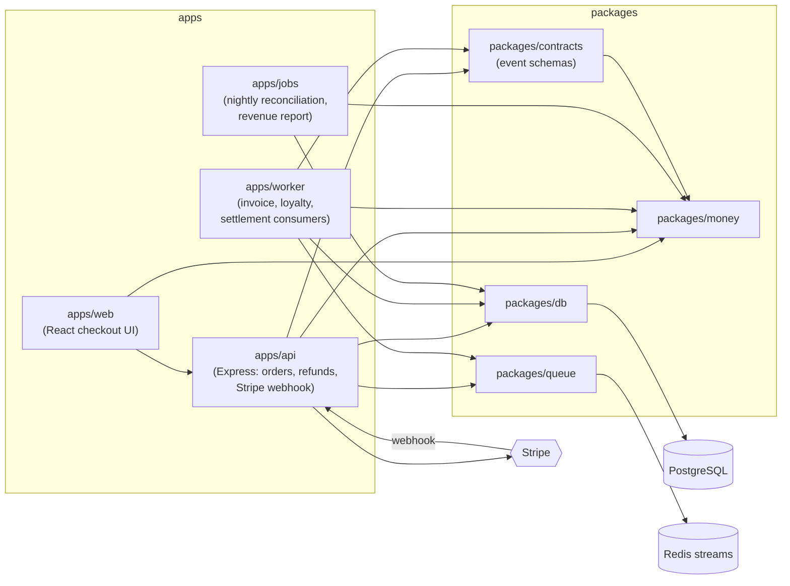

# Ledgerly — Blast Radius & Architecture Impact demo

Sample monorepo for demonstrating CodeRabbit's **Blast Radius** and
**Architecture Impact** analysis, available on the **Enterprise** tier.

Ledgerly is a small order, billing and settlement platform. It is split into
independently deployed services that share a handful of internal packages —
exactly the shape where a "small" change to a shared module quietly breaks a
service nobody touched in the PR.

## Architecture



| System               | Kind    | Depends on                          |
| -------------------- | ------- | ----------------------------------- |
| `apps/api`           | API     | money, contracts, db, queue, Stripe |
| `apps/worker`        | Worker  | money, contracts, db, queue         |
| `apps/jobs`          | Cron    | money, db                           |
| `apps/web`           | UI      | money, contracts                    |
| `packages/money`     | Library | —                                   |
| `packages/contracts` | Library | money                               |
| `packages/db`        | Library | PostgreSQL                          |
| `packages/queue`     | Library | Redis                               |

Events on the Redis stream are plain JSON. Producers (`apps/api`) and
consumers (`apps/worker`) deploy independently, and payloads are **not**
validated at runtime, so the TypeScript compiler cannot protect a consumer
from a producer-side contract change.

## Running locally

```bash
docker compose up -d
pnpm install
pnpm dev:api
pnpm dev:worker
```

## The demo

Open the pull requests on this repository with CodeRabbit (Enterprise) installed
and look at the **Blast Radius** and **Architecture Impact** views in the review
for the systems each change reaches beyond the files in its diff.
